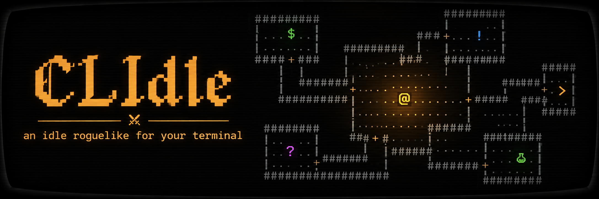

<p align="center"></p>

# CLIdle

**English** · [Português](README.pt.md)

> ⚠️ **Made with AI.** The code, texts and design of this project were built with the help of AI agents (Claude Code), directed and reviewed by the author.

An **idle terminal game** with a medieval fantasy feel and a dungeon explorer in the style of the classic roguelikes (Rogue, NetHack).

The idea is to keep a small terminal open in a corner and watch the `@` explore the dungeon on his own, while you drop in now and then to prepare the next expedition.

```
 1 Main  2 Preparation  3 Hero                HP 38/43 · lv 4 · floor 3 · 120 gold
            ------------------
            |................|    ------------------
            |.........$......+####+.....>....r.....|
            |....@...........|    ---+--------------
            -------------+----       #
You hit the rat (5) · the rat hits you (2)
You kill the rat! +3 XP, +1 gold
You equip Short Sword (rare, Atk +8).
```

## How it works

- **Classes:** warrior, mage, rogue or cleric, chosen at the start. Each one uses its own weapons and armor and unlocks abilities and spells by level.
- **Expeditions:** the hero leaves town, goes down floor by floor and comes back with what he found.
- **Return or die:** if he comes back, he keeps the gold and sells the bag. If he dies, he loses the expedition's loot but keeps his level, potions and the gear he left with.
- **Fully automatic:** he explores, fights, picks up items, equips whatever is better and drinks potions on his own.
- **Automatic retreat:** you decide when he comes back (low HP with no potions, full bag, last floor).
- **Town:** shop, blacksmith and permanent training, paid with the gold from expeditions.
- **Chest:** with "Sell loot on return" off, what he finds goes to the chest and you choose what to equip or sell. With auto-equip off, he never swaps gear on his own.
- **Bosses every 10 floors:** they guard the stairs, drop an epic item and unlock a shortcut (start on floor 11, 21...).
- **Offline progress:** when you reopen it, the game simulates the time it was closed (up to 12h) and shows a summary.
- **Adaptive layout:** works from 40×10 up to large screens; the camera follows the `@` when the map does not fit.

## Requirements

- Linux or Windows (x86-64)
- A terminal with color support (256 colors recommended)
- To build: Go 1.25 or newer

## Install

Download the binary for your system from the [Releases](https://github.com/deivao06/CLIdle/releases/latest) page:

- **Linux:** `clidle-linux-amd64`
  ```sh
  chmod +x clidle-linux-amd64
  ./clidle-linux-amd64
  ```
- **Windows:** `clidle-windows-amd64.exe` (run it from Windows Terminal)

  The first time, Windows may show **"Windows protected your PC"** (SmartScreen). That happens because the `.exe` has no paid digital signature, not because it does anything wrong. Click **More info → Run anyway**. If you would rather check it first, compare the file with the release's `SHA256SUMS` or build it from source (below).

The game **tells you** when a new version is out: when the hero gets back to town, it checks the releases (at most once an hour). "New version vX · u update" shows up at the top. Press `u` and confirm: it downloads, checks the checksum, swaps the binary and restarts with your save intact. The current version is shown in the bottom right corner.

## Play in the browser and on your phone

Open **https://deivao06.github.io/CLIdle/**. It is the same game, compiled to WebAssembly, and it works **offline** after the first visit.

- **iPhone:** open it in Safari → **Share** button → **Add to Home Screen**. Always open it from the icon: it runs full screen and Safari does not erase the save.
- **Android:** in Chrome, menu → **Install app** (or **Add to Home screen**).
- **Touch:** tap a tab, row or button. In a list, the 1st tap selects and the 2nd uses it; on values, tap `‹` or `›`. Drag your finger to scroll.
- The browser save is **separate** from the PC save.
- The first visit downloads about 3.5 MB. New versions arrive on their own and apply the next time the game opens.

## Build from source

```sh
git clone git@github.com:deivao06/CLIdle.git
cd CLIdle
CGO_ENABLED=0 go build -ldflags="-s -w" -o clidle .   # static binary, runs on any Linux x86-64
./clidle
```

Local builds show the version `dev` and do not look for updates.

## Controls

| Key | Action |
|---|---|
| `1` | Main screen (dungeon; in town: campfire, blacksmith, training, shop and chest) |
| `2` | Preparation (settings for the next expedition) |
| `3` | Hero (attributes, gear, bag, records, last death) |
| `4` | Settings (beep, CRT effect, language, reset save, version) |
| `e` | Set out on the expedition (in town) |
| `r` | Call the hero back (in the dungeon) |
| `a` | Turn auto-expedition on/off |
| `u` | Update (when there is a new version) |
| `?` | Symbol legend and help |
| `q` | Save and quit |

In **Preparation**: `↑↓` or `j/k` choose, `←→` or `h/l` adjust, `enter` toggles.

**Tactics** (end of Preparation): the hero's AI is a list of **when → do → until** rules, read from top to bottom every step (e.g. `HP < 30% → Flee, until done` or `enemies in sight ≥ 3 → Flee`; every number accepts `<`, `>`, `≤` and `≥`). `enter` on a rule opens the editor (`←→` change each field, `esc` goes back). The default list is the hero's usual behavior (heal, potion at HP < 40%, retreat, attack); how he walks the dungeon follows the **Mode**; the **Tactics** page of the help (`?`) explains everything.

In **town** (screen 1): `↑↓` choose, `enter` buys or equips, `x` sells from the chest.

In **Hero**: `↑↓` or `j/k` scroll the screen when it does not fit.

In **confirmations**: `y` or `enter` confirm; `n` or `esc` cancel.

The **mouse** works too: click tabs, rows and buttons (1st click selects, 2nd uses). To select text in the terminal, hold `Shift`.

## Legend

| Symbol | Meaning |
|---|---|
| `@` | hero |
| `.` `#` `+` | floor, corridor, door |
| `>` `<` | stairs down, exit |
| `$` `!` | gold, potion |
| `)` `[` `]` `^` `}` | weapon, armor, boots, helmet, shield |
| `r` `b` `k` `g`... | monsters (lowercase letter) |
| `G` `O` `L` `D` | bosses (uppercase letter) |

Item color = rarity: white common, blue magic, green rare, purple epic, orange legendary.

## Save

- It lives in `~/.local/share/clidle/save.json` (or `$XDG_DATA_HOME/clidle/save.json`). In the browser, it lives in the site's storage.
- It saves every 30 seconds and when you quit.
- To start over, use **Reset save** on the Settings screen (`4`).
- The game opens in English; the language can be changed on the Settings screen (`4`).

## Playground

A lab to test the game in a controlled setup: you build floors, rooms, monsters, hero, gear and tactics, press play and watch the `@` act with **the same rules as the game**. It never touches your save. Desktop only (at least 136×30).

- **In the browser:** https://deivao06.github.io/CLIdle/playground/
- **On your PC:** download `clidle-playground-linux-amd64` or `clidle-playground-windows-amd64.exe` from the [Releases](https://github.com/deivao06/CLIdle/releases/latest) page.
- **From source:** `go run ./cmd/playground`

## Development

```sh
go test ./...          # tests for the game logic
go test -short ./...   # skips the 12h simulation performance test
go vet ./...
./web/build.sh         # web version in web/dist
cd web/dist && python3 -m http.server 8765   # open http://127.0.0.1:8765
```

- **Structure:**
  - `main.go`: loads the save and opens the interface.
  - `cmd/playground`: the playground.
  - `internal/game`: all the game logic, deterministic and without any interface.
  - `internal/ui`: interface in [Bubble Tea](https://github.com/charmbracelet/bubbletea) and [Lip Gloss](https://github.com/charmbracelet/lipgloss).
  - `web`: browser version ([xterm.js](https://xtermjs.org/), in `web/vendor` with its MIT license).
- **Balance:** every number lives in `internal/game/balance.go`.
- **Design:** design decisions in [`docs/design.md`](docs/design.md) (Portuguese).
- **For AI agents:** see [`AGENTS.md`](AGENTS.md) (Portuguese).

### Releases

```sh
git tag v0.2.0
git push origin v0.2.0
```

GitHub Actions (`.github/workflows/release.yml`) runs the tests, builds the Linux and Windows binaries (game and playground) with the version embedded, generates `SHA256SUMS` and publishes the release. The notes are built from the commits since the previous tag, in English: `feat:` becomes **What's new** and `fix:` becomes **Fixes**.

`.github/workflows/pages.yml` publishes the web version (game and `/playground/`) on GitHub Pages on every tag (or manually, under **Actions → pages → Run workflow**).
