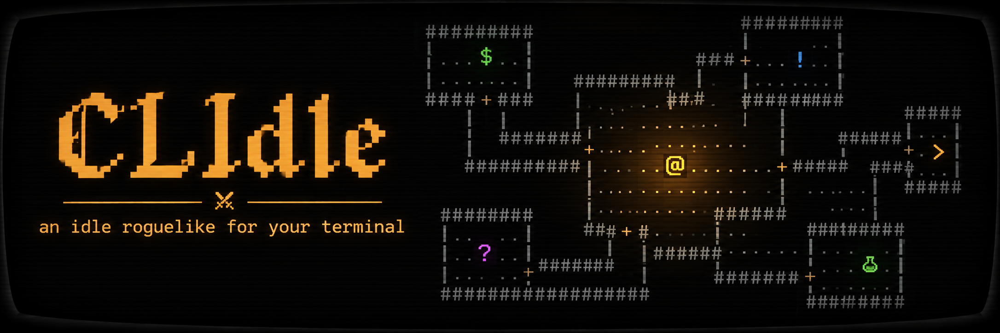

<p align="center"></p>

# CLIdle

[English](README.md) · **Português**

> ⚠️ **Feito com uso de IA.** O código, os textos e o design deste projeto foram desenvolvidos com a ajuda de agentes de IA (Claude Code), sob direção e revisão do autor.

Jogo **idle de terminal** com pegada de fantasia medieval e dungeon explorer no estilo dos roguelikes clássicos (Rogue, NetHack).

A ideia é deixar um terminal pequeno aberto num canto e ver o `@` explorando a dungeon sozinho, enquanto você entra de vez em quando para preparar a próxima expedição.

```
 1 Principal  2 Preparação  3 Herói              HP 38/43 · nv 4 · andar 3 · 120 ouro
            ------------------
            |................|    ------------------
            |.........$......+####+.....>....r.....|
            |....@...........|    ---+--------------
            -------------+----       #
Você acerta o rato (5) · o rato te acerta (2)
Você mata o rato! +3 XP, +1 ouro
Você equipa Espada Curta (raro, Atq +8).
```

## Como funciona

- **Classes:** guerreiro, mago, ladino ou clérigo, escolhida no começo. Cada uma usa armas e armaduras próprias e libera habilidades e magias por nível.
- **Expedições:** o herói sai da cidade, desce andar por andar e volta com o que achou.
- **Sair ou morrer:** se voltar, guarda o ouro e vende a mochila. Se morrer, perde o loot da expedição, mas mantém nível, poções e o equipamento com que saiu.
- **Tudo automático:** ele explora, luta, pega itens, equipa o que for melhor e bebe poções sozinho.
- **Retirada automática:** você define quando ele volta (HP baixo sem poções, mochila cheia, último andar).
- **Cidade:** loja, ferreiro e treino permanente, pagos com o ouro das expedições.
- **Baú:** com "Vender loot na volta" desligado, o que ele acha vai para o baú e você escolhe o que equipar ou vender. Com auto-equipar desligado, ele não troca de equipamento sozinho.
- **Chefes a cada 10 andares:** guardam a escada, deixam cair um item épico e liberam um atalho (começar no andar 11, 21...).
- **Progresso offline:** ao reabrir, o jogo simula o tempo em que ficou fechado (até 12h) e mostra um resumo.
- **Layout adaptável:** funciona de 40×10 até telas grandes; a câmera segue o `@` quando o mapa não cabe.

## Requisitos

- Linux ou Windows (x86-64)
- Terminal com suporte a cores (256 cores recomendado)
- Para compilar: Go 1.25 ou mais novo

## Instalar

Baixe o binário do seu sistema na página de [Releases](https://github.com/deivao06/CLIdle/releases/latest):

- **Linux:** `clidle-linux-amd64`
  ```sh
  chmod +x clidle-linux-amd64
  ./clidle-linux-amd64
  ```
- **Windows:** `clidle-windows-amd64.exe` (rode pelo Windows Terminal)

  Na primeira vez, o Windows pode mostrar **"Windows protected your PC"** (SmartScreen). Isso acontece porque o `.exe` não tem assinatura digital paga, não porque ele faça algo errado. Clique em **More info → Run anyway**. Se preferir conferir antes, compare o arquivo com o `SHA256SUMS` da release ou compile do código (abaixo).

O jogo **avisa sozinho** quando sai uma versão nova: ao abrir o jogo e ao voltar à cidade, ele consulta as releases (no máximo 1 vez por hora). Aparece "Nova versão vX · u atualizar" no topo. Com `u` e a confirmação, ele baixa, confere o checksum, troca o binário e reinicia com o save intacto. A versão atual aparece no canto direito do rodapé.

## Jogar no navegador e no celular

Abra **https://deivao06.github.io/CLIdle/**. É o mesmo jogo, compilado para WebAssembly, e funciona **sem internet** depois da primeira visita.

- **iPhone:** abra no Safari → botão **Compartilhar** → **Adicionar à Tela de Início**. Abra sempre pelo ícone: assim ele roda em tela cheia e o Safari não apaga o save.
- **Android:** no Chrome, menu → **Instalar app** (ou **Adicionar à tela inicial**).
- **Toque:** toque numa aba, linha ou botão. Numa lista, o 1º toque escolhe e o 2º usa; nos valores, toque em `‹` ou `›`. Arraste o dedo para rolar.
- O save do navegador é **separado** do save do PC.
- A primeira abertura baixa uns 3,5 MB. Versões novas chegam sozinhas e valem na próxima vez que o jogo abrir.

## Compilar do código

```sh
git clone git@github.com:deivao06/CLIdle.git
cd CLIdle
CGO_ENABLED=0 go build -ldflags="-s -w" -o clidle .   # binário estático, roda em qualquer Linux x86-64
./clidle
```

Builds locais mostram a versão `dev` e não procuram atualizações.

## Controles

| Tecla | Ação |
|---|---|
| `1` | Tela principal (dungeon; na cidade: fogueira, ferreiro, treino, loja e baú) |
| `2` | Preparação (config da próxima expedição) |
| `3` | Herói (atributos, equipamento, mochila, recordes, última morte) |
| `4` | Config (bip, efeito CRT, idioma, resetar save, versão) |
| `e` | Partir para a expedição (na cidade) |
| `r` | Mandar o herói voltar (na dungeon) |
| `a` | Ligar/desligar a auto-expedição |
| `u` | Atualizar (quando há versão nova) |
| `?` | Legenda dos símbolos |
| `q` | Salvar e sair |

Na **Preparação**: `↑↓` ou `j/k` escolhem, `←→` ou `h/l` ajustam, `enter` alterna.

**Táticas** (fim da Preparação): a IA do herói é uma lista de regras **quando → fazer → até**, lida de cima para baixo a cada passo (ex.: `HP < 30% → Fugir, até terminar` ou `inimigos à vista ≥ 3 → Fugir`; todo número aceita `<`, `>`, `≤` e `≥`). `enter` numa regra abre o editor (`←→` mudam cada campo, `esc` volta). A lista padrão é o jeito de sempre do herói (cura, poção com HP < 40%, recuo, ataque); o jeito de andar pela dungeon segue o **Modo**; a página **Táticas** da ajuda (`?`) explica tudo.

Na **cidade** (tela 1): `↑↓` escolhem, `enter` compra ou equipa, `x` vende do baú.

No **Herói**: `↑↓` ou `j/k` rolam a tela quando ela não cabe.

Nas **confirmações**: `s`, `y` ou `enter` confirmam; `n` ou `esc` cancelam.

O **mouse** também funciona: clique nas abas, linhas e botões (1º clique escolhe, 2º usa). Para selecionar texto no terminal, segure `Shift`.

## Legenda

| Símbolo | Significado |
|---|---|
| `@` | herói |
| `.` `#` `+` | chão, corredor, porta |
| `>` `<` | escada para baixo, saída |
| `$` `!` | ouro, poção |
| `)` `[` `]` `^` `}` | arma, armadura, botas, capacete, escudo |
| `r` `b` `k` `g`... | monstros (letra minúscula) |
| `G` `O` `L` `D` | chefes (letra maiúscula) |

Cor do item = raridade: branco comum, azul mágico, verde raro, roxo épico, laranja lendário.

## Save

- Fica em `~/.local/share/clidle/save.json` (ou `$XDG_DATA_HOME/clidle/save.json`). No navegador, fica no armazenamento do site.
- Salva a cada 30 segundos e ao sair.
- Para recomeçar do zero, use **Resetar save** na tela Config (`4`).
- O jogo abre em inglês; o idioma muda na tela Config (`4`).

## Playground

Um laboratório para testar o jogo em ambiente controlado: você monta andares, salas, monstros, herói, equipamento e táticas, aperta play e vê o `@` agir com **as mesmas regras do jogo**. Não mexe no save. Só para desktop (mínimo 136×30).

- **No navegador:** https://deivao06.github.io/CLIdle/playground/
- **No PC:** baixe `clidle-playground-linux-amd64` ou `clidle-playground-windows-amd64.exe` na página de [Releases](https://github.com/deivao06/CLIdle/releases/latest).
- **Do código:** `go run ./cmd/playground`

## Desenvolvimento

```sh
go test ./...          # testes da lógica do jogo
go test -short ./...   # pula o teste de desempenho da simulação de 12h
go vet ./...
./web/build.sh         # versão web em web/dist
cd web/dist && python3 -m http.server 8765   # abrir http://127.0.0.1:8765
```

- **Estrutura:**
  - `main.go`: carrega o save e abre a interface.
  - `cmd/playground`: o playground.
  - `internal/game`: toda a lógica do jogo, sem interface e determinística.
  - `internal/ui`: interface em [Bubble Tea](https://github.com/charmbracelet/bubbletea) e [Lip Gloss](https://github.com/charmbracelet/lipgloss).
  - `web`: versão de navegador ([xterm.js](https://xtermjs.org/), em `web/vendor` com a licença MIT dele).
- **Balanceamento:** todos os números ficam em `internal/game/balance.go`.
- **Design:** decisões de design em [`docs/design.md`](docs/design.md).
- **Para agentes de IA:** veja [`AGENTS.md`](AGENTS.md).

### Releases

```sh
git tag v0.2.0
git push origin v0.2.0
```

O GitHub Actions (`.github/workflows/release.yml`) roda os testes, compila os binários de Linux e Windows (jogo e playground) com a versão embutida, gera o `SHA256SUMS` e publica a release. As notas são montadas a partir dos commits desde a tag anterior, em inglês: `feat:` vira **What's new** e `fix:` vira **Fixes**.

O `.github/workflows/pages.yml` publica a versão web (jogo e `/playground/`) no GitHub Pages a cada tag (ou manualmente, em **Actions → pages → Run workflow**).
